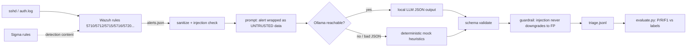

# L1-Copilot — local-LLM triage for Wazuh/SSH alerts

> **Lab project.** All 100 alerts are **synthetic lab data** (see `data/generate_dataset.py`). No real logs, IPs or users. 

## Problem
L1 SOC analysts lose hours to SSH noise: scanners, typos, ansible runs, admins on travel. Cloud LLM triage isn't an option when logs can't leave the network (data residency / India's DPDP Act). L1-Copilot sends each Wazuh alert to a **local** LLM (Ollama) that returns a **TP/FP verdict, MITRE ATT&CK technique, severity, confidence and reasoning**. Every result is scored against my own labels.

## Architecture


## Layout
| Path | What |
|---|---|
| `l1copilot/triage.py` | Ollama client, prompt, mock fallback, guardrails |
| `l1copilot/sanitize.py` | field sanitising + prompt-injection detection |
| `l1copilot/schema.py` | output schema / MITRE allow-list |
| `l1copilot/evaluate.py` | precision / recall / F1 / MITRE accuracy |
| `data/alerts_lab.jsonl` | 100 labelled alerts (57 TP / 43 FP), seeded so it reproduces exactly |
| `sigma/` | 3 SSH Sigma rules (brute force, spray, success-after-failures) |
| `tests/` | pytest (11 tests) |

## Run
```bash
python3 -m venv .venv && .venv/bin/pip install -r requirements-dev.txt
.venv/bin/pytest -q
python3 -m l1copilot.evaluate --engine mock                 # no GPU needed
python3 -m l1copilot.cli data/alerts_lab.jsonl -o out.jsonl # auto: Ollama if up, else mock
# with a local LLM
ollama pull llama3.1:8b && OLLAMA_MODEL=llama3.1:8b python3 -m l1copilot.evaluate --engine ollama
# Docker
docker compose run --rm triage                  # mock fallback
docker compose --profile llm up -d ollama && docker compose run --rm triage
```

## Results (actual runs, 2026-10-11, CPU-only box with 8 vCPU and no GPU)
Positive class = `true_positive`. n = 100.

| Engine | Precision | Recall | F1 | Accuracy | MITRE acc. on TP | Runtime |
|---|---|---|---|---|---|---|
| Mock heuristics (baseline) | **0.927** | **0.895** | **0.911** | 0.90 | 0.98 | <0.1 s |
| Ollama qwen2.5:1.5b (Q4), prompt v1 | 0.667 | 0.070 | 0.127 | 0.45 | 0.00 | 203 s |
| Ollama qwen2.5:1.5b (Q4), prompt v2 (verdict definitions) | 0.667 | 0.105 | 0.182 | 0.46 | 0.00 | 142 s |

Raw outputs are in `results/`. Not yet measured: llama3.1:8b or larger models. The box had about 2 GB free RAM, so I only ran the 1.5B model.

**Where the misses are.** The mock misses all 10 "hard" cases on purpose. Those cases need context that isn't in the alert: an internal host that has been compromised, a low-and-slow brute force, and travel-VPN or CI egress IPs. The 1.5B LLM flags 82/100 alerts as `none`/benign. It mixes up the security meaning of "false positive" with "the attack failed", for example reasoning that a brute-force attempt is "a false positive scenario" because the user doesn't exist.

## Limitations
- Synthetic data, and I wrote both the labels and the heuristics. The mock's F1 is optimistic and does **not** measure real-world performance.
- 100 alerts, single SSH log source, one labeller (me), so there is no inter-rater agreement.
- The LLM was evaluated only with a 1.5B quantised model on CPU. Larger models are untested.
- Sigma rules are schema-checked only. They haven't been converted with pySigma or replayed against a live Wazuh/SIEM.
- Prompt-injection detection is regex-based and easy to bypass. The real protection is structural: data is wrapped as untrusted, outputs are allow-listed, and injection can never downgrade a verdict.

## Data sources (formats only)
- Loghub OpenSSH samples: https://github.com/logpai/loghub/tree/master/OpenSSH
- Wazuh sshd ruleset (rule IDs / descriptions): https://github.com/wazuh/wazuh/tree/master/ruleset/rules
- Wazuh alert format: https://documentation.wazuh.com/current/user-manual/manager/alert-management.html
- MITRE ATT&CK T1110 / T1078 / T1021.004 / T1548.003 / T1136.001 / T1046: https://attack.mitre.org
- IPs use RFC 5737 documentation ranges and RFC 1918.

## Related work

This is my own implementation. Ideas came from [aaronphifer/triagewall](https://github.com/aaronphifer/triagewall).
